TRƯỜNG ĐẠI HỌC CÔNG NGHỆ THÔNG TIN – ĐHQG-HCM

KHOA HỆ THỐNG THÔNG TIN

### IS355 – CÔNG NGHỆ BLOCKCHAIN

# Proposal

### Đánh giá rủi ro tín dụng bằng AI có khả năng giải thích, tích hợp khả năng kiểm toán dựa trên Blockchain

Nhóm: Nhóm 7 – Super Bells

Lớp: IS355.R11.CTTT.2

Ngày lập: 12/11/2026 · Cập nhật: 25/11/2026

Thời gian thực hiện: Tháng 10–12/2026

TP. Hồ Chí Minh, 2026

## A. THÔNG TIN

| Trường thông tin | Giá trị |
| --- | --- |
| Học phần | IS355 – Công nghệ Blockchain |
| Tên đề tài | Đánh giá rủi ro tín dụng bằng AI có khả năng giải thích, tích hợp khả năng kiểm toán dựa trên Blockchain |
| Loại đồ án | Nguyên mẫu định hướng nghiên cứu mức 3 |
| Nhóm | Nhóm 7 – Super Bells |
| Ngày lập | 12/11/2026; cập nhật 25/11/2026 |

| STT | Thành viên | MSSV | Nhiệm vụ |
| --- | --- | --- | --- |
| 1 | Trần Hùng Vĩ | 23521776 | Kỹ thuật dữ liệu; khảo sát đặc điểm và tiền xử lý bộ dữ liệu |
| 2 | Phạm Quốc Vinh | 23521794 | Huấn luyện mô hình; đánh giá và phân tích lỗi |
| 3 | Lê Tự Nhân | 23521076 | Tổng quan nghiên cứu liên quan; giải thích mô hình bằng SHAP |
| 4 | Trần Đình Duy | 23520390 | Hợp đồng thông minh Vyper; phân quyền và kiểm thử |
| 5 | Trần Quốc Hải | 23520424 | Web3.py; tạo mã băm và xác minh bản ghi |
| 6 | Nguyễn Văn Nguyên | 23521053 | Dashboard Streamlit; tích hợp và trình diễn |

## B. NỘI DUNG

## Tóm tắt

Đánh giá rủi ro tín dụng cần kết quả dự đoán có thể giải thích và một cách kiểm tra xem bản ghi quyết định có bị sửa sau khi công bố hay không. Dự án lấy Cheon và cộng sự (ICLR 2025) làm mốc phương pháp: tái lập ROC-AUC của Logistic Regression (LR), Random Forest (RF) và XGBoost trên FICO HELOC, German Credit và Give Me Some Credit bằng mã và phép chia dữ liệu của tác giả. FICO HELOC là bộ dữ liệu chính cho luồng tích hợp; German Credit và Give Me Some Credit là các thực nghiệm tái lập độc lập. Cải tiến I1 tạo bản ghi quyết định off-chain gồm xác suất P(Bad), giải thích SHAP cục bộ và phiên bản hiện vật mô hình; JSON chuẩn hóa được băm SHA-256, lưu cùng bản ghi trong SQLite, còn Vyper chỉ lưu decision_id và hai cam kết băm. B0 (SQLite), B1 (SQLite cùng mã băm) và B2 (SQLite cùng cam kết on-chain) sẽ được so sánh trên cùng hồ sơ về khả năng phát hiện sửa đổi, cảnh báo sai, gas và độ trễ. Hiện nhóm đã tái lập 9 tổ hợp dataset–mô hình và chạy pilot ba hồ sơ HELOC qua LR, bản ghi schema v2, Anvil và màn hình xác minh; đánh giá B0/B1/B2 quy mô đầy đủ, Sepolia và SHAP/RESP mở rộng vẫn là công việc tiếp theo. Nguyên mẫu không đưa dữ liệu cá nhân thô lên chuỗi và không dùng để phê duyệt khoản vay thực tế.

## 1. Giới thiệu và câu hỏi nghiên cứu

Dự án giải quyết hai vấn đề riêng: tái lập kết quả dự đoán tín dụng có thể đối chiếu với nghiên cứu công bố, và kiểm tra bản ghi dự đoán–giải thích sau khi lưu. Cheon và cộng sự cung cấp mã, phép chia và bảng ROC-AUC để đối chiếu; I1 bổ sung dấu cam kết độc lập cho bản ghi off-chain. Blockchain không thực hiện suy luận mô hình và việc xác minh mã băm không chứng minh tính đúng đắn của dữ liệu hay mô hình.

| RQ | Câu hỏi nghiên cứu |
| --- | --- |
| RQ1 | Có thể tái lập ROC-AUC của LR, RF và XGBoost theo Cheon et al. trên FICO HELOC, German Credit và Give Me Some Credit đến mức nào khi giữ nguyên dữ liệu, phép chia, nhãn và cấu hình của từng bộ? |
| RQ2 | Trên mô hình LR HELOC đã cố định, giải thích SHAP cục bộ cho P(Bad) trong không gian log-odds có thỏa tính cộng được không, và những giới hạn nào ngăn việc diễn giải nó như quan hệ nhân quả hoặc recourse? |
| RQ3 | Cam kết SHA-256 on-chain có phát hiện sửa đổi bản ghi dự đoán–giải thích off-chain tốt hơn B0/B1 dưới cùng kịch bản tấn công không; chi phí gas và độ trễ là bao nhiêu? |

## 2. Nghiên cứu liên quan và phạm vi rõ ràng

| Bài báo | Nội dung kế thừa / hạn chế |
| --- | --- |
| [1] Cheon và cộng sự (2025) | Nghiên cứu nền chính: dữ liệu FICO HELOC, German Credit và Give Me Some Credit; mã tác giả, phép chia, LR/RF/XGBoost và ROC-AUC Table 11. Phần RESP/recourse của bài báo là mốc nghiên cứu, chưa được xem là kết quả nhóm đã tái lập. |
| [2] Hlongwane và cộng sự (2024) | Tham khảo phương pháp so sánh mô hình tín dụng và giải thích dự đoán bằng SHAP. Nghiên cứu tập trung vào khả năng giải thích của mô hình tín dụng. |
| [3] Černevičienė & Kabašinskas (2024) | Củng cố việc lựa chọn SHAP và các giới hạn diễn giải: đóng góp thuộc tính không chứng minh quan hệ nhân quả, tính công bằng hoặc độ đáng tin. Hạn chế chính: (1) tài liệu khảo sát chỉ đến năm 2022. |
| [4] Liang và cộng sự (2017) | Điều chỉnh nguyên lý truy xuất nguồn gốc cho bản ghi quyết định tín dụng và kiểm thử cam kết SHA-256 từng bản ghi trong sổ đăng ký Vyper; không xem đây là cách triển khai tương đương bằng chứng Merkle. Hạn chế chính: (1) truy xuất nguồn gốc tệp đám mây, không phải quyết định tín dụng bằng AI. |

Cheon et al. [1] là cơ sở để tái lập dự đoán trên các bộ dữ liệu tín dụng công khai và đối chiếu ROC-AUC. Hlongwane et al. [2] và tổng quan XAI [3] hỗ trợ cách trình bày giải thích cùng giới hạn diễn giải; ProvChain [4] gợi ý cơ chế truy xuất nguồn gốc, nhưng I1 áp dụng cam kết trực tiếp cho bản ghi quyết định thay vì Merkle proof. Nhóm không khẳng định SHAP chứng minh quan hệ nhân quả, công bằng hay khả năng thay đổi quyết định. Học sâu, học liên kết, ZK, phê duyệt vay DeFi, hệ thống ngân hàng thực tế và PII on-chain nằm ngoài phạm vi.

## 3. Phương pháp và cải tiến

Phát triển mô hình: Nhóm dùng dữ liệu và mã Cheon et al. ở commit cố định [1], [5], xử lý riêng FICO HELOC, German Credit và Give Me Some Credit, rồi so kết quả LR/RF/XGBoost với ROC-AUC Table 11; không gộp các bộ và không đánh giá chuyển giao mô hình. Dữ liệu sau bước setup có kích thước lần lượt 5.842 × 43, 1.000 × 36 và 120.268 × 23. Phép chia tham chiếu là K05N01, seed 2338, test fold 5; với HELOC có 4.674 bản ghi train và 1.168 bản ghi test. Give Me Some Credit có bước oversampling trong mã tác giả, kể cả tập đánh giá, nên số bản ghi sau resampling phải báo riêng và không diễn giải như số hồ sơ gốc. Luồng tích hợp I1 chọn hiện vật LR HELOC đã cố định: xác suất rủi ro P(Bad) và đóng góp SHAP tuyến tính trong không gian log-odds được kiểm tra trước khi làm tròn. Bản ghi được lưu trong SQLite, chuẩn hóa và băm SHA-256; Vyper nhận decision_id, record_hash và model_version_hash. Bộ xác minh trả VERIFIED, MISMATCH, PENDING hoặc NOT_FOUND theo bản ghi và giao dịch đã xác nhận.

Đặc tả I1: Với FICO HELOC, bản ghi R dùng schema_version = "2" và dataset_id = "fico_heloc_iclr2025"; cấu trúc vẫn gồm decision_id ngẫu nhiên, input_reference bút danh, model_version, model_artifact_sha256, risk_probability, shap_explanation, timestamp_utc và nonce. Giải thích ghi method, output_space, base_value, model_output và các feature_contributions; HELOC pilot sử dụng 43 đặc trưng trong không gian raw log-odds của lớp Bad. Số thực được ghi thành chuỗi thập phân cố định 8 chữ số; Unicode NFC; khóa JSON sắp tăng dần đệ quy; các đóng góp sắp theo tên đặc trưng; JSON UTF-8 không có khoảng trắng thừa và cấm NaN/Infinity. SHAP additivity được kiểm tra trước khi làm tròn. SQLite lưu byte JSON chuẩn hóa để tính lại record_hash = SHA256(CanonicalSerialize(R)); model_version_hash = SHA256(UTF-8(model_version + "|" + model_artifact_sha256)). Trên chuỗi chỉ lưu decision_id và hai mã băm, không lưu hồ sơ gốc, xác suất hoặc giải thích.

```mermaid
flowchart LR
    S1["S1 FICO HELOC"] --> S2["S2 Tiền xử lý Cheon"] --> S3["S3 K05N01 fold 5"] --> S4["S4 LR RF XGBoost"]
    S4 --> S5["S5 LR HELOC cố định"] --> S6["S6 P Bad"] --> S7["S7 SHAP log odds"] --> S8["S8 JSON v2 và SQLite"]
    S8 --> S9["S9 SHA 256"] --> S10["S10 Vyper trên Anvil"] --> S11["S11 Xác minh on chain và off chain"]
```

Hình 1. Quy trình off-chain/on-chain và vị trí của cải tiến I1.

## 3.1. Các baseline, chỉ số và đánh giá

| Baseline / phép thử | Mục đích | Cách đo |
| --- | --- | --- |
| LR/RF/XGBoost theo Cheon trên ba bộ dữ liệu | Tái lập kết quả dự đoán | ROC-AUC train/test so với Table 11; báo split, seed và sai lệch. PR-AUC, Recall, F1 là đánh giá bổ sung nếu triển khai. |
| B0: bản ghi SQLite thông thường | Không có cam kết toàn vẹn độc lập | Tỷ lệ phát hiện sửa đổi, cảnh báo sai và độ trễ trên cùng hồ sơ |
| B1: bản ghi và mã băm nằm trong cùng SQLite | Mã băm vẫn có thể sửa cùng bản ghi | Tỷ lệ phát hiện khi bản ghi và hash cùng bị sửa; cảnh báo sai và độ trễ |
| B2: bản ghi off-chain + cam kết on-chain | Điểm neo bảo đảm toàn vẹn độc lập | Tỷ lệ phát hiện, cảnh báo sai, gas, độ trễ xác nhận và phân quyền |
| Kiểm tra SHAP trên LR HELOC | Hành vi giải thích | Sai số cộng được trên log-odds P(Bad); phân tích cục bộ. RESP/recourse là nghiên cứu mở rộng, chưa hoàn thành. |

## 3.2. Kế hoạch dữ liệu

| Bộ dữ liệu | Quy mô/đặc điểm | Cách sử dụng và lưu ý |
| --- | --- | --- |
| FICO HELOC (bộ chính) | Nguồn tác giả: 10.459 × 24; sau setup 5.842 × 43. K05N01 fold 5: 4.674 train, 1.168 test. | Tái lập LR/RF/XGBoost; dùng LR đã cố định cho SHAP, bản ghi schema v2 và audit blockchain. Ghi checksum, xử lý mã thiếu −9/−8, chiều nhãn Bad/Good và split. |
| German Credit | Nguồn tác giả: 1.000 × 62; sau setup 1.000 × 36. | Thực nghiệm tái lập độc lập và kiểm tra độ vững; không dùng mô hình HELOC để dự đoán German. |
| Give Me Some Credit | Nguồn tác giả: 150.000 × 11; sau setup 120.268 × 23. | Thực nghiệm tái lập độc lập; ghi rõ oversampling trong mã tác giả và số mẫu đánh giá sau resampling. |

Nguồn dữ liệu và kết quả tái lập đã được kiểm tra theo checksum, commit tác giả, seed và cấu hình ghi trong nhật ký [5]. Trên cùng 1.168 hồ sơ test HELOC, ROC-AUC tính bằng scikit-learn từ P(Bad) lần lượt là 0,7882 cho LR, 0,7866 cho RF và 0,7902 cho XGBoost. Pipeline LR chuẩn hóa đầu vào một lần khi dự đoán. Đây là kết quả của seed 2338. Phân tích EDA chi tiết, đối chiếu nhiều lần chạy và kiểm thử B0/B1/B2 là bước tiếp theo.

## 3.3. Công cụ và kiến trúc

| Tầng | Công nghệ |
| --- | --- |
| Học máy và khả năng giải thích | Python 3, pandas, scikit-learn, XGBoost; mã Cheon cố định; giải thích LR theo công thức SHAP tuyến tính |
| Cơ sở dữ liệu và tính toàn vẹn | SQLite, hashlib/SHA-256, mã hóa JSON theo quy tắc xác định |
| Blockchain | Vyper 0.4.x, Web3.py, Anvil; Ape và Sepolia trong kế hoạch kiểm thử chính thức |
| Giao diện | Streamlit: màn hình pilot đọc bản ghi, trạng thái xác minh, giao dịch và gas; giao diện đầy đủ là bước tiếp theo |

## 4. Kế hoạch thực hiện

| Giai đoạn | Công việc dự kiến | Sản phẩm |
| --- | --- | --- |
| Nghiên cứu + thiết kế | Chốt Cheon et al. làm nghiên cứu nền; nguồn, phép chia, checksum, cấu trúc bản ghi và giao thức B0/B1/B2 | Đề cương cập nhật, nhật ký dữ liệu và kế hoạch kiểm thử |
| Phát triển | Tái lập 9 tổ hợp ROC-AUC; xây LR/SHAP HELOC, schema v2, SQLite và Vyper; bổ sung EDA và thử nghiệm nhiều seed | Đã có bảng đối chiếu Table 11 và pilot HELOC; cần hoàn thiện bộ đánh giá |
| Tích hợp | Web3.py + SQLite + Streamlit; chạy Anvil pilot, mở rộng kiểm thử Ape/Sepolia | Đã có 3 bản ghi HELOC xác minh trên Anvil; giao diện và Sepolia còn trong kế hoạch |
| Đánh giá + báo cáo | Thử B0/B1/B2 trên các hồ sơ ghép cặp; đo phát hiện/cảnh báo sai, gas/độ trễ và phân quyền | Bảng kết quả chính thức, giới hạn nghiên cứu, báo cáo và demo |

## 5. Kết quả dự kiến và giới hạn

Kết quả đã có là bảng ROC-AUC tái lập 9 tổ hợp dataset–mô hình theo Table 11 và pilot ba hồ sơ HELOC với LR, giải thích tuyến tính, bản ghi schema v2 và cam kết Anvil: bản gốc VERIFIED, bản sao sửa đổi MISMATCH. Các kết quả này chỉ chứng minh luồng cục bộ ở quy mô pilot. Kết quả dự kiến tiếp theo gồm phân tích độ vững, so sánh B0/B1/B2 trên cùng hồ sơ, kiểm thử phân quyền và cảnh báo sai, đo gas/độ trễ nhiều lần, kiểm thử Sepolia và giao diện demo đầy đủ. Xác minh mã băm chỉ xác nhận bản ghi off-chain khớp cam kết on-chain; nó không xác nhận dữ liệu đầu vào đúng, mô hình công bằng, giải thích được thực thi đúng hoặc kho off-chain luôn sẵn có. Hệ thống không dùng để phê duyệt khoản vay thực tế và không công bố PII.

## Tài liệu tham khảo

[1] J. Cheon, W. Wernerfelt, S. A. Friedler, and B. Ustun, “Feature Responsiveness Scores: Model-Agnostic Explanations for Recourse,” ICLR, 2025, Appendix B.4, Table 11. https://proceedings.iclr.cc/paper_files/paper/2025/hash/6662eaf34893d9827ddf60c29e9ad6af-Abstract-Conference.html

[2] R. Hlongwane, K. Ramaboa, and W. Mongwe, “A novel framework for enhancing transparency in credit scoring: Leveraging Shapley values for interpretable credit scorecards,” PLOS ONE, vol. 19, no. 8, e0308718, 2024. doi: 10.1371/journal.pone.0308718.

[3] J. Černevičienė and A. Kabašinskas, “Explainable artificial intelligence (XAI) in finance: A systematic literature review,” Artificial Intelligence Review, vol. 57, article 216, 2024. doi: 10.1007/s10462-024-10854-8.

[4] X. Liang, S. Shetty, D. Tosh, C. Kamhoua, K. Kwiat, and L. Njilla, “ProvChain: A blockchain-based data provenance architecture in cloud environment with enhanced privacy and availability,” in Proc. IEEE/ACM CCGrid, pp. 468–477, 2017. doi: 10.1109/CCGRID.2017.8.

[5] Cheon et al., author implementation, branch paper/iclr2025, commit 4c68c73b34eef7c5e38847274048cb3ab66d702c; Super Bells, replication log and comparison CSV, 19/11/2026. https://github.com/ustunb/responsiveness/tree/paper/iclr2025

[6] T. Chen and C. Guestrin, “XGBoost: A scalable tree boosting system,” in ACM SIGKDD, 2016. doi: 10.1145/2939672.2939785.

[7] S. M. Lundberg and S.-I. Lee, “A unified approach to interpreting model predictions,” in NeurIPS, 2017. https://papers.nips.cc/paper/7062-a-unified-approach-to-interpreting-model-predictions.
